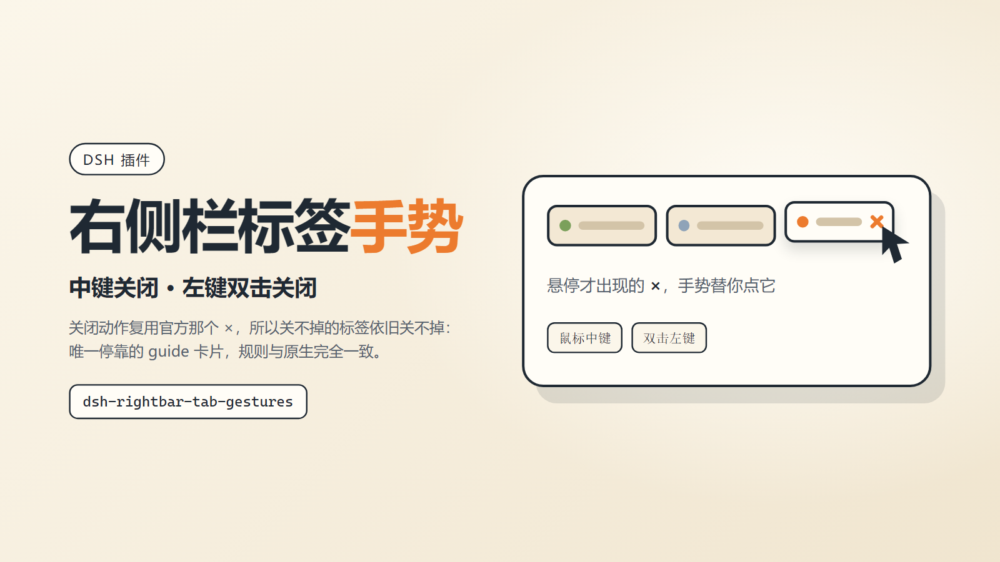

# dsh-rightbar-tab-gestures



DeepSeek Harness 右侧栏的标签页，支持**鼠标中键关闭**和**左键双击关闭**，手感与浏览器标签一致。

## 行为

| 操作 | 结果 |
| --- | --- |
| 标签上按鼠标中键 | 关闭该标签 |
| 标签上双击左键 | 关闭该标签，并清掉双击选中的标题文字 |
| 点在 `×` 上 | 不动手（否则一次双击会连关两三个） |
| 唯一停靠的 guide 标签 | 关不掉（它本来就没有 `×`） |

中键按下时会在标签上吞掉 Chromium 的自动滚动（那个上下箭头圆圈），但在别处按中键不受影响。右键菜单、拖拽排序、`×` 按钮本身的悬停显隐都保持原样。

## 为什么不用自己的关闭逻辑

没有受支持的插槽能改标签胶囊的交互，所以手势是页面级事件捕获；但**关闭动作本身不碰布局存储**，而是去点官方渲染的那个 `×` 按钮：

- `×` 只在标签「可关闭」时才渲染（`canCloseTab`：唯一停靠的 guide 返回 `false`），所以"关不掉的还是关不掉"是自动成立的，不需要我这里再抄一遍规则；
- 关闭后的焦点回落、各标签 `close` 处理器的清理、面板空掉后的收起，全部由官方逻辑完成。

定位用的是 dockkit 自己的契约属性 `data-dockkit-tab` / `data-dockkit-tab-close`，不是哈希类名（`_tab_6nhg2_134` 这种会随构建变）。

## 安装

### 方式一：GUI 安装框（推荐）

设置 → 插件 → 安装，填入包名：

```
dsh-rightbar-tab-gestures
```

### 方式二：命令行

```bash
dsh plugin --profile desktop add dsh-rightbar-tab-gestures
```

### 方式三：让助手装

对助手说「装 dsh-rightbar-tab-gestures」，它会调用 `plugin_manager action=install_bundle target=dsh-rightbar-tab-gestures`。注意 `install_bundle` 是模型工具而不是 shell 命令，`npm i` 只改依赖、不登记 `dsh.profile.bundles`，不能当安装手段。

### 本地目录（开发用）

`install_bundle` 同样接受一个绝对路径（例如 `F:\ForAI\dsh-rightbar-tab-gestures`），会以 `link:` 方式挂进 profile，改完刷新页面即可。

装好之后**刷新 Web GUI 页面**（客户端模块随页面加载）。若是替换已安装的同名包，需要重启 DSH 桌面端才会加载新的模块版本。

## 生效范围

- 只在 Web GUI 里生效——桌面端与浏览器打开的是同一套 Web 前端，两边都管用。
- 手势作用在所有 dockkit 标签胶囊上，所以停靠面板与浮窗里的标签都能用（浮窗这条路没有逐窗口实测）。

## 兼容性与已知限制

- 依赖 dockkit 标签条的 `data-dockkit-tab*` 属性。上游哪天换掉这套契约，手势会**静默失效**（不会误伤别的操作）：表现为中键/双击不再关闭，其余一切正常。
- 不碰 Pin：标签模型里没有"钉住"字段，排序也没有对外 API，做了也只能是表面功夫，所以不做。
- 关标签的快捷键、右键菜单里的关闭项都不受影响，也不会被手势拦截。

## 开发

```bash
node test-gestures.mjs      # 伪 DOM 跑真文件，校验事件接线
```

测试直接 `import('./lib/client.js')`，用假的 `window.__ModuleLoader__`、`Element` 和 `document` 驱动真实代码，断言：中键关一次、双击关一次并 `preventDefault`、点在 `×` 上不额外动作、非标签区域不响应、清理后监听归零、模块 id 与 `package.json` 里的包名一致（防改名漂移）。

品牌资产由 `assets/render.mjs` 渲染（Chrome DevTools Protocol，固定布局视口，避免 Windows 缩放下截边）：

```bash
node assets/render.mjs assets/icon.svg.html assets/icon-512.png 512 512 1
node assets/render.mjs assets/cover.html assets/cover-1600x900.png 1600 900 1
```

改了 `assets/icon.svg` 或 `assets/cover.html` 之后，按同样参数重出 `icon-{64,128,256,512,1024}.png` 与 `cover-{1600x900,3200x1800}.png`。

## 分发

发版以 **tag 为准**：`npm publish` 由 `.github/workflows/release.yml` 在推送 `v*` 标签时执行，用 npm trusted publishing（OIDC）发布，附 provenance，仓库里不放长期 token。

一次性准备：

1. 在 npm 上创建包 `dsh-rightbar-tab-gestures`；
2. 打开 https://www.npmjs.com/package/dsh-rightbar-tab-gestures/access → Trusted publisher，绑定 GitHub 仓库 `dmscode/dsh-rightbar-tab-gestures`、workflow 文件名 `release.yml`；
3. 把 `package.json` 的版本与 `CHANGELOG.md` 的条目写好，然后：

```bash
git tag v1.0.0
git push origin main --tags
```

### 新包的首发要手动一次

npm 的 trusted publisher 只能挂在**已经存在**的包上（PyPI 可以给还不存在的包配 OIDC，npm 不行），所以第一个版本必须手工发：

```bash
npm login                      # 走浏览器 + 2FA / passkey
npm publish --access public    # 会停在验证上，浏览器里确认
npm trust github dsh-rightbar-tab-gestures --file release.yml \
  --repo dmscode/dsh-rightbar-tab-gestures --allow-publish
```

`npm trust` 同样要 2FA，而且只认真实终端：非交互环境下它会直接 `EOTP` 退出，不会帮你开浏览器。首发之后（这里是 1.0.1 起）才轮到推 tag 自动发。

顺带一个容易误会的现象：首发时 registry 上会先出现一个 `0.0.0-stage` 占位版本（description 是 "Temporary package placeholder for staged publishing"），那是 npm 12 staged publishing 预留包名用的，不用管，它不影响 `latest`。

流水线会先校验 tag 与 `package.json` 版本一致、跑 `npm test`，再发布、轮询确认版本已进 registry，最后用 `scripts/release-notes.mjs` 从 `CHANGELOG.md` 取正文、附上 `npm pack` 的 tgz 创建 GitHub Release。

## License

MIT
